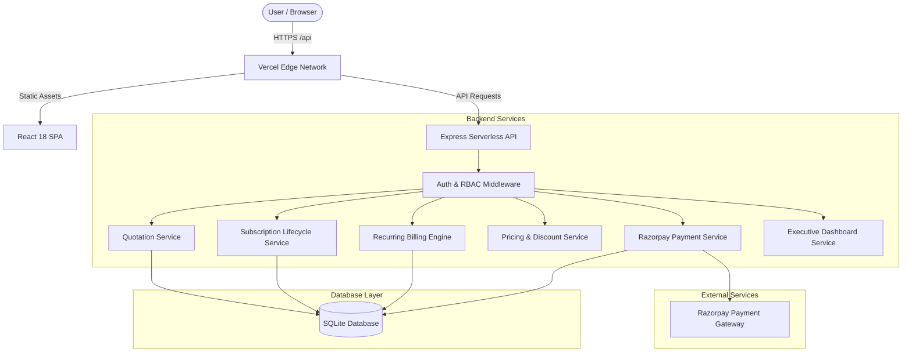
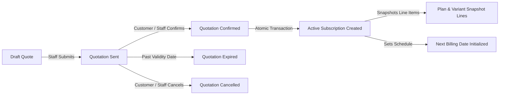
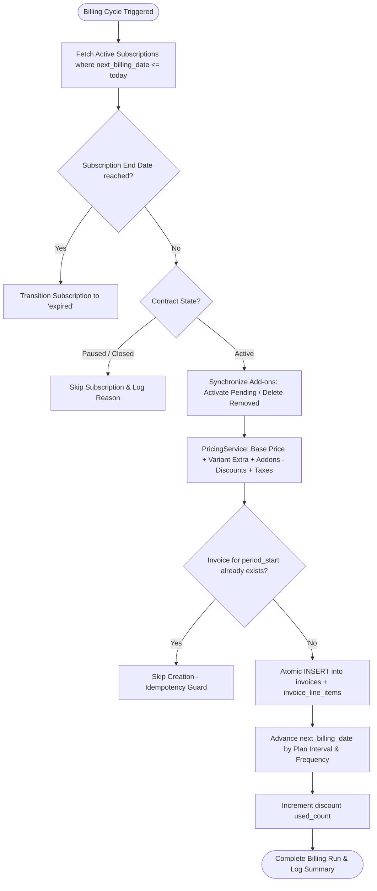
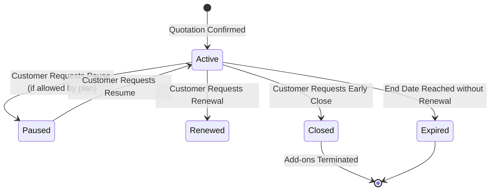

# Brightloop Subscription Manager

<div align="center">


### Unified Full-Lifecycle Subscription Management & Recurring Billing Platform

[](https://brightloop-subscription-manager-five.vercel.app)
[](https://github.com/atharvbhavsar/Odoo_subscription-)
[](https://nodejs.org)
[](https://react.dev)
[](https://www.typescriptlang.org)
[-brightgreen?style=for-the-badge)](docs/TESTING.md)

**Live Production URL:** [https://brightloop-subscription-manager-five.vercel.app](https://brightloop-subscription-manager-five.vercel.app)  
**API Health Status:** [https://brightloop-subscription-manager-five.vercel.app/api/health](https://brightloop-subscription-manager-five.vercel.app/api/health)

</div>

---

## Table of Contents
1. [Project Overview](#project-overview)
2. [Live Links & Submission Details](#live-links--submission-details)
3. [Technology Stack](#technology-stack)
4. [System Architecture & Workflow Diagrams](#system-architecture--workflow-diagrams)
   - [End-to-End System Workflow](#1-end-to-end-system-workflow)
   - [Quotation to Subscription Lifecycle](#2-quotation-to-subscription-lifecycle)
   - [Automated Recurring Billing Engine](#3-automated-recurring-billing-engine)
   - [Customer Self-Service Lifecycle](#4-customer-self-service-lifecycle)
5. [Role-Based Access Control (RBAC) & Test Credentials](#role-based-access-control-rbac--test-credentials)
6. [Core Functional Modules](#core-functional-modules)
7. [Database Schema & Migrations](#database-schema--migrations)
8. [Local Development & Quick Start](#local-development--quick-start)
9. [Automated Testing Suite](#automated-testing-suite)
10. [Production Deployment Architecture](#production-deployment-architecture)
11. [Project Team & Contributions](#project-team--contributions)
12. [Documentation Directory](#documentation-directory)

---

## Project Overview

**Brightloop Subscription Manager** is an enterprise-grade SaaS subscription management and recurring billing web application. Built to support multi-cadence billing, complex product catalogs with variant pricing, date-valid taxes and discounts, full quotation lifecycles, transaction-safe billing runs, Razorpay payments, and customer self-service capabilities.

### Key Highlights
- **Authoritative Backend Pricing:** Prevents client-side price tampering via server-evaluated `PricingService`.
- **Multi-Cadence Billing Engine:** Supports daily, weekly, monthly, and yearly recurring periods with calendar-safe leap-year date math.
- **Strict Financial Idempotency:** Guarantees zero duplicate invoices via database-level composite unique constraints `(subscription_id, period_start)`.
- **Subscription Add-On Engine:** Manages full add-on lifecycles (`pending_activation`, `active`, `pending_removal`, `removed`) coordinated with contract billing dates.
- **Payment Gateway Integration:** Razorpay checkout with HMAC-SHA256 signature verification, idempotency tracking, partial payment allocation, and failure auditing.
- **Customer Self-Service Portal:** Ownership-protected interface allowing customers to view contracts, download PDF statements, settle balances, and modify add-ons.

---

## Live Links & Submission Details

| Item | Details |
|---|---|
| **Live Web App** | [https://brightloop-subscription-manager-five.vercel.app](https://brightloop-subscription-manager-five.vercel.app) |
| **API Health Check** | `GET` [https://brightloop-subscription-manager-five.vercel.app/api/health](https://brightloop-subscription-manager-five.vercel.app/api/health) |
| **Source Code Repository** | [https://github.com/atharvbhavsar/Odoo_subscription-](https://github.com/atharvbhavsar/Odoo_subscription-) |
| **Production Branch** | `main` |
| **Integration Branch** | `brightloop-final-integration` |
| **Deployment Target** | Vercel Serverless Platform |
| **Project Members** | **Ruturaj** (Member A) & **Atharv** (Member B) |

---

## Technology Stack

```
┌────────────────────────────────────────────────────────────────────────┐
│                             TECH STACK                                 │
├─────────────────┬──────────────────────────────────────────────────────┤
│ Frontend SPA    │ React 18, TypeScript, Vite 5, Tailwind CSS, Lucide   │
│ Client State    │ React Context API, React Router DOM v6               │
├─────────────────┼──────────────────────────────────────────────────────┤
│ Backend API     │ Node.js 20 LTS, Express 4, TypeScript, tsx           │
│ Database        │ SQLite (Node built-in module), Schema Migrations     │
├─────────────────┼──────────────────────────────────────────────────────┤
│ Security & Auth │ bcrypt, express-session (HTTP-only), Bearer Fallback  │
│ Payments        │ Razorpay SDK (Test Mode), HMAC-SHA256 Verification   │
│ Invoicing & PDF │ PDFKit, Safe 2-Decimal Precision Arithmetic          │
├─────────────────┼──────────────────────────────────────────────────────┤
│ Hosting & Cloud │ Vercel Serverless Functions + Static CDN Edge        │
│ Version Control │ Git, GitHub Actions compatible test harness          │
└─────────────────┴──────────────────────────────────────────────────────┘
```

---

## System Architecture & Workflow Diagrams

### 1. End-to-End System Workflow



---

### 2. Quotation to Subscription Lifecycle



---

### 3. Automated Recurring Billing Engine



---

### 4. Customer Self-Service Lifecycle



---

## Role-Based Access Control (RBAC) & Test Credentials

The platform provides granular, database-enforced Role-Based Access Control. Default accounts are pre-seeded in the database:

| Role | Email | Password | Permissions & Scope |
|---|---|---|---|
| **Admin** | `admin@brightloop.com` | `Password@123` | **Full Administrative Access**: Product catalog, variant pricing, plan creation, tax & discount management, manual recurring billing execution, all invoices, all payments, executive analytics dashboard. |
| **Staff** | `staff@brightloop.com` | `Password@123` | **Operational Access**: Quotation drafting, quotation templates, customer onboarding, subscription lifecycle management, invoice review, offline payment recording. |
| **Customer** | `customer@acme.com` | `Password@123` | **Self-Service Access**: Strict customer data boundary. Access restricted exclusively to their own profile, subscriptions, quotations, invoices, add-on requests, and Razorpay checkout. |

> **Security Note:** Session cookies use `SameSite: None`, `Secure: True`, and `HttpOnly` attributes. A fallback Bearer JWT mechanism is included for clients with restricted cookie policies.

---

## Core Functional Modules

```
brightloop-subscription-manager/
├── backend/
│   ├── src/
│   │   ├── modules/
│   │   │   ├── auth/           # Login, registration, password reset, RBAC guards
│   │   │   ├── billing/        # Recurring billing engine, billing run endpoint
│   │   │   ├── customers/      # Customer directory and profile management
│   │   │   ├── dashboard/      # Executive MRR, revenue, and collection aggregates
│   │   │   ├── discounts/      # PricingService, fixed/percentage discount rules
│   │   │   ├── invoices/       # Invoice CRUD, immutable line snapshots, PDF generator
│   │   │   ├── payments/       # Razorpay orders, HMAC verification, failure logs
│   │   │   ├── plans/          # Subscription plan tiers, cadences, bundled lines
│   │   │   ├── products/       # Products, categories, variant price adjustments
│   │   │   ├── quotations/     # Quotation lifecycle, line items, template presets
│   │   │   ├── subscriptions/  # Subscription state machine, add-ons management
│   │   │   └── taxes/          # Tax rates, start/end validity dates
│   │   └── index.ts            # Express server entry point
│   ├── database/               # SQL migrations (001 - 009) & seed files
│   └── tests/                  # 12 automated test suites (119 test cases)
├── frontend/
│   ├── src/
│   │   ├── pages/              # Admin, Staff, and Customer views
│   │   ├── components/         # Modals, Navbar, Badges, DataTables
│   │   ├── services/           # Axios-based API client modules
│   │   └── context/            # AuthContext, Role guards
│   └── tests/                  # 48 frontend unit tests
└── docs/                       # Architecture, DB schema, and API specifications
```

---

## Database Schema & Migrations

All database structures are version-controlled across 9 sequential SQL migrations:

```
001_initial_schema.sql                  -> Core tables: users, profiles, products, variants, plans, subscriptions, invoices, payments
002_quotation_templates.sql             -> Template headers and reusable line items
003_invoice_emails.sql                  -> Email audit tracking on invoices
004_subscription_addons.sql             -> Subscription add-on state machine (pending/active/removed)
005_product_variants_active.sql         -> Active/inactive soft toggle on variants
006_plan_improvements.sql               -> Multi-interval frequencies and pause/renewal plan policies
007_tax_discount_improvements.sql       -> Start/end validity windows and usage limit counters
008_quotation_lifecycle_improvements.sql -> Quotation state transitions, validity dates, atomic confirmation
009_subscription_lifecycle_improvements.sql -> Pause/resume/renew/close tracking, automatic expiry, add-on cascading
```

---

## Local Development & Quick Start

### Prerequisites
- **Node.js**: `20.x` or higher
- **npm**: `10.x` or higher
- **Git**

### 1. Clone & Setup Backend
```bash
git clone https://github.com/atharvbhavsar/Odoo_subscription-.git
cd Odoo_subscription-/backend

# Install backend dependencies
npm install

# Create local environment configuration
cp .env.example .env

# Run database migrations and load sample seeds
npm run migrate
npm run seed

# Start backend server (starts on http://localhost:5000)
npm run dev
```

### 2. Setup Frontend
```bash
cd ../frontend

# Install frontend dependencies
npm install

# Start Vite development server (starts on http://localhost:5173)
npm run dev
```

### 3. Open Application
Navigate to `http://localhost:5173` in your browser and log in with any test account from the credentials table.

---

## Automated Testing Suite

The repository contains a total of **167 automated tests** (119 backend + 48 frontend).

```
========================================================================
                          TEST RESULTS MATRIX
========================================================================
Backend Test Suites (12 suites, 119 total tests):
  ✓ auth_tests.ts                  (8/8 passed)   - Password complexity, RBAC, Reset
  ✓ billing_tests.ts               (10/10 passed) - Billing engine, catch-up, rounding
  ✓ invoice_tests.ts               (10/10 passed) - Snapshot immutability, PDF, numbering
  ✓ pdf_email_tests.ts             (8/8 passed)   - PDF rendering, email tracking
  ✓ dashboard_tests.ts             (8/8 passed)   - Real SQL aggregates, MRR formulas
  ✓ billing_run_http_tests.ts      (10/10 passed) - Billing run API, admin authorization
  ✓ addon_tests.ts                 (12/12 passed) - Add-on pricing, lifecycle, ownership
  ✓ quotation_tests.ts             (12/12 passed) - Quotation lifecycle, templates, confirm
  ✓ customer_portal_tests.ts       (11/11 passed) - Self-service boundaries, invoices
  ✓ subscription_lifecycle_tests.ts(13/13 passed) - Pause, resume, renew, close, clamp
  ✓ billing_integration_tests.ts   (16/16 passed) - End-to-end billing, payments, taxes
  ✓ run_tests.ts                   (14/14 passed) - Comprehensive system smoke test

Frontend Unit Tests (48 total tests):
  ✓ Add-on logic & validation      (9/9 passed)
  ✓ UI Helpers & formatting        (5/5 passed)
  ✓ Plan validation & RBAC         (6/6 passed)
  ✓ Product & Variant pricing      (5/5 passed)
  ✓ Quotation expiry & mutability  (5/5 passed)
  ✓ Subscription state transitions (4/4 passed)
  ✓ Tax & Discount rules           (5/5 passed)
  ✓ Quotation Templates            (3/3 passed)
  ✓ Customer Portal security       (6/6 passed)
========================================================================
TOTAL: 167 / 167 TESTS PASSED (100% SUCCESS RATE)
========================================================================
```

### Run Backend Tests
```bash
cd backend
npm run test:all
```

### Run Frontend Tests
```bash
cd frontend
npm test
npm run build
```

---

## Production Deployment Architecture

The application is deployed to **Vercel** as a hybrid single-page app and serverless REST API:

```
Vercel Edge Network
  ├── Route: /api/*  ──> api/index.js (Express Serverless Function)
  │                         └── SQLite Database initialized via bundled migrations
  └── Route: /*      ──> frontend/dist/ (Static SPA Assets)
```

- **Live URL:** [https://brightloop-subscription-manager-five.vercel.app](https://brightloop-subscription-manager-five.vercel.app)
- **Deployment Command:** `npx vercel --prod --yes`
- **Configuration:** `vercel.json` maps incoming routes and environment configuration.

---

## Project Team & Contributions

This project was developed collaboratively by Team Brightloop:

| Developer | Role | Responsibilities |
|---|---|---|
| **Ruturaj** (Member A) | Backend Architect & Lifecycle Engineer | - Step 9: Quotation Management, Templates, Line Snapshots<br>- Step 10: Subscription Lifecycle (Pause/Resume/Renew/Close, Calendar Clamping)<br>- Database Migrations 008 & 009<br>- Auth Bearer Token Resilience |
| **Atharv** (Member B) | Fullstack Engineer & Billing Architect | - Step 11: Customer Self-Service Portal & Ownership Isolation<br>- Step 12: Billing Engine Integration (Add-ons, Taxes, Discounts, Payment Status)<br>- Step 13: End-to-End Verification, Documentation Suite, Vercel Production Deployment |

---

## Documentation Directory

For in-depth engineering documentation, refer to the `docs/` folder:

- [API Contract Specification](docs/API_CONTRACT.md) — Comprehensive REST API documentation with endpoints, payloads, and error codes.
- [Database Schema Reference](docs/DATABASE_SCHEMA.md) — ER specifications, table schemas, foreign key constraints, and migrations.
- [Billing Engine Integration Guide](docs/BILLING_INTEGRATION.md) — In-depth recurring billing calculation formulas, discount ordering, and add-on timing.
- [Testing & Quality Assurance Guide](docs/TESTING.md) — Test setup, individual test suite commands, and CI test matrices.
- [Project Architecture & System Design](docs/PROJECT_ARCHITECTURE.md) — System boundaries, data flow diagrams, security policies, and cold-start handling.
- [Deployment & Operations Guide](docs/DEPLOYMENT.md) — Serverless Vercel setup, environment variables, Render/Railway alternatives, and rollback steps.
- [Product Requirements Document (PRD)](docs/PRD.md) — Business requirements and user stories.
- [Project Development Rules](docs/PROJECT_RULES.md) — Architectural conventions and database constraints.

---

<div align="center">
  <b>Brightloop Subscription Manager — Production Ready</b>
</div>
